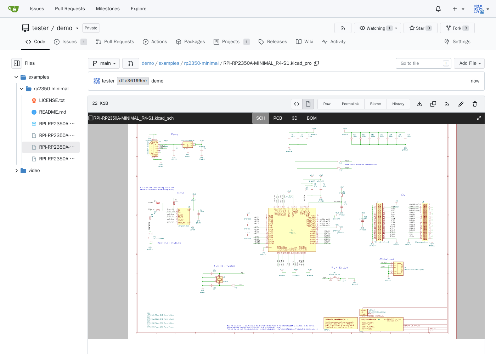
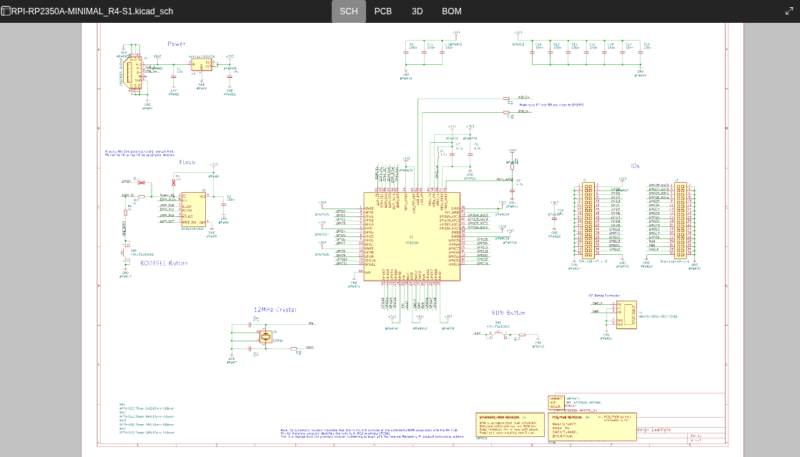
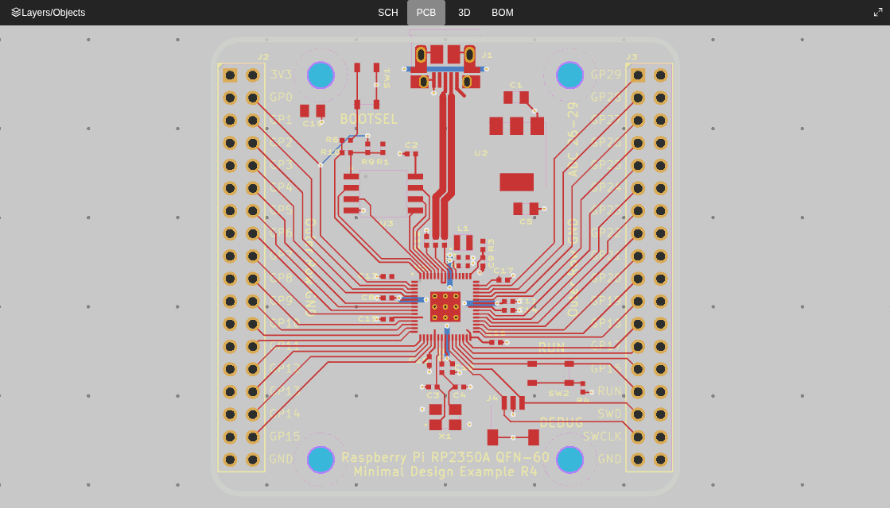
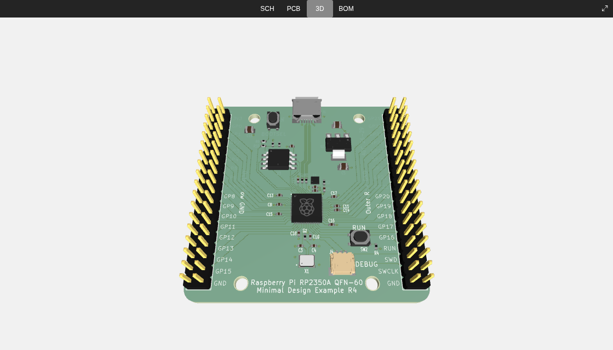
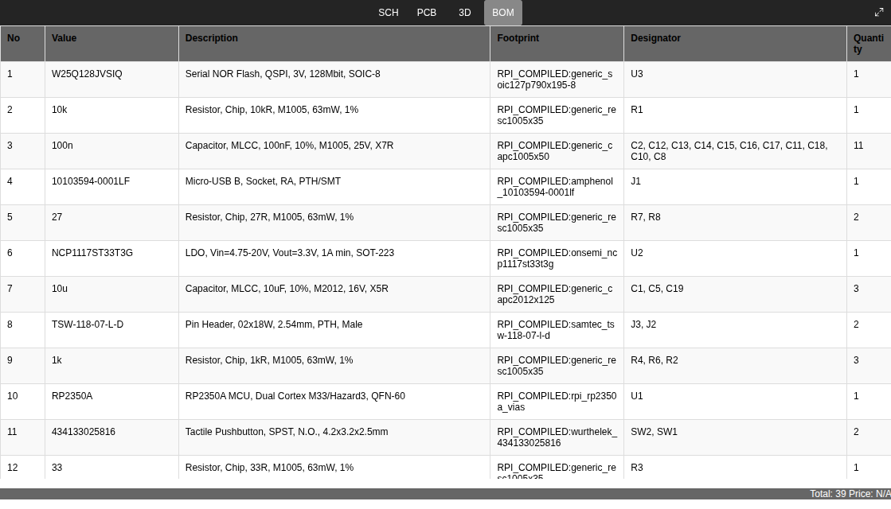

# gitea-kicad-viewer: view KiCad projects in Gitea

[](https://github.com/Vandewaetere/gitea-kicad-viewer/actions/workflows/test.yml)
[](https://github.com/Vandewaetere/gitea-kicad-viewer/releases/latest)

**Browse [KiCad](https://www.kicad.org) schematics, PCBs, 3D boards and BOMs right inside [Gitea](https://about.gitea.com).** Click a `.kicad_pro`, `.kicad_sch` or `.kicad_pcb` file in a repository and get an interactive viewer instead of a wall of S-expressions. Everything renders in the browser and is served by your own Gitea: no external services, no CDN, no KiCad install needed to look at a design, and it works for private repositories.

It plugs into Gitea's own external renderer: no Gitea patches, no plugin system, just a few files and an `app.ini` section.

## Screenshots

All screenshots show Raspberry Pi's RP2350A Minimal Design, the [example project](examples/rp2350-minimal/) in this repository.

### 1. A KiCad project in Gitea's file view

Open the `.kicad_pro` (or any `.kicad_sch` / `.kicad_pcb`) and the viewer takes the place of the file contents. Gitea's own button next to *Raw* switches back to the source.



### 2. Schematic

All sheets of the project, with pan, zoom and symbol properties.



### 3. PCB

Layers on/off, nets and footprints.



### 4. 3D

The board with its components, from a `.glb` next to the project.



### 5. BOM

The bill of materials, generated from the schematic.



## Features

- Interactive schematic viewer: pan, zoom, symbol properties, hierarchical sheets
- Interactive PCB viewer: layers on/off, nets, footprints
- BOM view
- 3D view of the board, from a `.glb` next to the project (KiCad: *File → Export → GLB*, or
  `kicad-cli pcb export glb`); without one the 3D tab is hidden
- KiCad 6 and later (tested with KiCad 10 files)
- No external requests, works for private repositories
- Works side by side with [gitea-board-badges](https://github.com/Vandewaetere/gitea-board-badges) in the same `$GITEA_CUSTOM`

## How it works

Gitea runs `render.sh` for every KiCad file it shows and puts the result in a sandboxed iframe. That page loads
[ecad-viewer](https://github.com/Huaqiu-Electronics/ecad-viewer) from Gitea's `/assets/kicad-viewer/`, plus a small
loader that makes the viewer work inside Gitea's sandbox.

| Gitea sandbox | What you see |
|---|---|
| default (`allow-scripts …`) | the file you opened (one schematic sheet or one PCB), no 3D |
| with `allow-same-origin` (recommended) | the whole project in that folder: all sheets, the PCB, the BOM and (with a `.glb`) 3D, in tabs |

`allow-same-origin` lets the viewer read the other files of the project with the visitor's own session (only what
that visitor may see anyway). Only add it if you trust the render command: this one only reads files and never puts
their content into the page as HTML.

## Installation

Download `gitea-kicad-viewer.tar.gz` from the [latest release](https://github.com/Vandewaetere/gitea-kicad-viewer/releases/latest)
and unpack it into `$GITEA_CUSTOM` (with the official Docker image that is `/data/gitea`):

```sh
curl -fLO https://github.com/Vandewaetere/gitea-kicad-viewer/releases/latest/download/gitea-kicad-viewer.tar.gz
tar -xzf gitea-kicad-viewer.tar.gz -C /data/gitea
```

That gives `public/assets/kicad-viewer/` (the viewer) and `kicad-viewer/render.sh` (the render command). Then add to
`app.ini` and restart Gitea:

```ini
[markup.kicad]
ENABLED                = true
FILE_EXTENSIONS        = .kicad_pro,.kicad_sch,.kicad_pcb
RENDER_COMMAND         = sh /data/gitea/kicad-viewer/render.sh
RENDER_CONTENT_MODE    = iframe
; recommended, for whole projects and 3D (see above); leave it out to keep Gitea's default sandbox:
RENDER_CONTENT_SANDBOX = allow-scripts allow-same-origin allow-popups allow-downloads
```

With Docker you can also set these as environment variables (`GITEA__markup_0X2E_kicad__ENABLED=true`, …) and mount
the two folders read-only. If Gitea runs under a sub-path, set `KICAD_VIEWER_ASSETS` (default `/assets/kicad-viewer`)
in the environment of the render command.

To update, unpack the new release over the old one. The asset URLs carry the build version, so browsers pick up the
new files right away.

**Large boards:** Gitea does not render files above `[ui] MAX_DISPLAY_FILE_SIZE` (default 8 MiB). Raise it if your
`.kicad_pcb` files are bigger, or open the `.kicad_pro`: with `allow-same-origin` it loads the PCB directly.

**3D:** needs `allow-same-origin` and a `.glb` in the project folder, uncompressed or with meshopt compression
(Draco/KTX2 would need decoders from a CDN, which the viewer does not load).

### Building it yourself

```sh
./build.sh
```

Needs Docker and git; it builds ecad-viewer at a pinned commit in the official Node.js image and fills `dist/` with
the same layout as the release archive (`dist/public/assets/kicad-viewer/`, `dist/kicad-viewer/`). It empties those
folders instead of removing them, so a Gitea that bind-mounts them keeps working.

## Example project

[`examples/rp2350-minimal/`](examples/rp2350-minimal/) holds a small, validated, MIT-licensed KiCad 10 project to try
the viewer with: Raspberry Pi's official RP2350A Minimal Design, with a 3D model. Where it comes from, its license
and the ERC/DRC results are in its [README](examples/rp2350-minimal/README.md). Push it to a repository on your Gitea
and open the `.kicad_pro`.

## Testing

```sh
./build.sh && test/test.sh
GITEA_IMAGE=gitea/gitea:<version> test/test.sh   # another Gitea version, e.g. before upgrading
```

Starts a throwaway Gitea (official image) on an internal Docker network, with this viewer and gitea-board-badges
installed, pushes ecad-viewer's demo project (9 sheets) and the example project to a private repository and checks
the result in Chromium (Microsoft's official Playwright image), with and without `allow-same-origin`: every tab
opens, the 3D model loads, gitea-board-badges keeps working, no requests leave Gitea and there are no script errors.
Nothing touches any other Gitea. The screenshots above come from this test (`test/out/screenshot-*.png`).

On GitHub the test runs on every push and pull request.

## Releasing

1. Add a section `## [X.Y.Z] - date` to [CHANGELOG.md](CHANGELOG.md) and set the version at the top of `src/loader.js`.
2. Tag `vX.Y.Z` and push it. On GitHub, `.github/workflows/release.yml` builds the release archive and creates the
   release with that changelog section as notes.

## FAQ

**Can Gitea show KiCad schematics and PCBs?**
Not out of the box: it shows the raw S-expression text. With gitea-kicad-viewer, KiCad files open in an interactive viewer in Gitea's own file view.

**Does it need a Gitea plugin, an API token or an extra server?**
No. It is a render command and some static files served by Gitea itself. The viewer reads files with the visitor's own login and only reads.

**Does it work with private repositories?**
Yes. Every visitor only sees what they are allowed to see in Gitea.

**Does it send my designs anywhere?**
No. Everything is parsed and drawn in the visitor's browser. The test checks that no request leaves Gitea.

**Why is there no 3D tab?**
Either there is no `.glb` in the project folder, or the sandbox is Gitea's default (without `allow-same-origin`). Export a `.glb` in KiCad (*File → Export → GLB*) and commit it next to the project.

**Which KiCad and Gitea versions are supported?**
KiCad 6 and later. Tested with KiCad 10 files and Gitea 28.2.0; run `test/test.sh` with `GITEA_IMAGE=gitea/gitea:<version>` to check another Gitea version.

**Can I use it together with gitea-board-badges?**
Yes. gitea-board-badges uses `templates/custom/footer.tmpl`, this viewer uses no templates at all; the test runs with both installed.

## Credits

This project is built on the work of others, thank you:

- **[ecad-viewer](https://github.com/Huaqiu-Electronics/ecad-viewer)** by **Huaqiu Electronics** (MIT): the viewer this project is based on.
- **[KiCanvas](https://github.com/theacodes/kicanvas)** by **Thea Flowers** (MIT): the KiCad web viewer ecad-viewer itself is based on.
- **[three.js](https://threejs.org)** (MIT): the 3D view (r161, as shipped with ecad-viewer).
- **[three-gltf-viewer](https://github.com/donmccurdy/three-gltf-viewer)** by **Don McCurdy** (MIT): used by ecad-viewer for the 3D view.
- **[Raspberry Pi Ltd](https://www.raspberrypi.com)** (MIT): the example project in `examples/rp2350-minimal/`.

Inside Gitea the loader hides ecad-viewer's logo in the corner of the viewer; the credits are here instead. Their
license notices are kept with the code taken from them; `build.sh` copies ecad-viewer's license next to the
built files. ecad-viewer's bundles also contain [Comlink](https://github.com/GoogleChromeLabs/comlink) (Apache-2.0).

## License

[MIT](LICENSE) © Giovanni Vandewaetere

---

**Nederlands:** toont KiCad-projecten (schema's, PCB's, 3D en stuklijst) in Gitea, rechtstreeks in de bestandsweergave, in plaats van de ruwe tekst. Alles draait in de browser en komt van je eigen Gitea: geen externe diensten, werkt ook voor privérepo's. Het is gebouwd op ecad-viewer van Huaqiu Electronics en werkt samen met gitea-board-badges. Installatie en tests staan hierboven.
